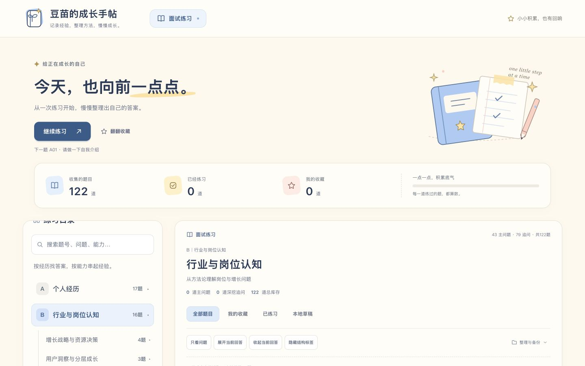
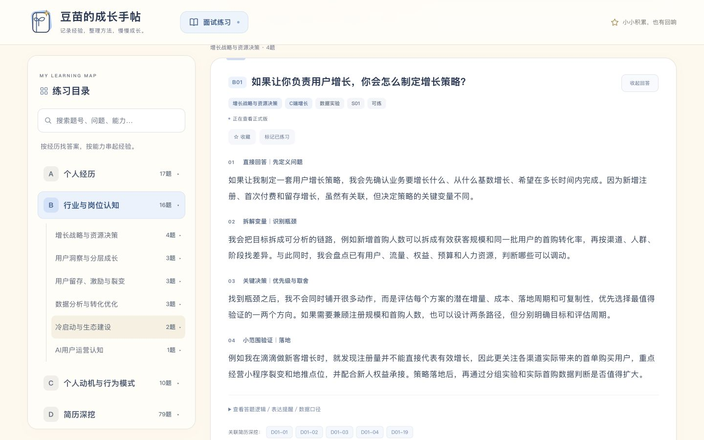
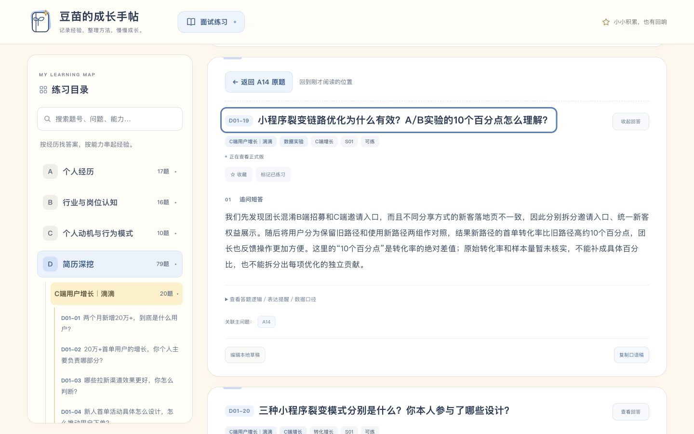

# 进入练习与关联题返回验收

基于main `00e5f1509d41a4d5e73f81cbe77092a185261e05` 的独立改动，供PR审核，未直接发布到main。

## 行为

- 点击一级分类后，欢迎语、插画和学习概览收起；左侧目录占用品牌栏下方区域，正文直接定位该类第一道题。全类题目按能力小类分段展示，二级分类仍可继续筛选。再次点击当前一级分类只折叠目录，当前分类题目仍然保留。
- 点击关联题时保存来源上下文。目标题卡上方显示“返回 A14 原题”等按钮，返回搜索/收藏等原筛选、答案展开、草稿视图、详情展开及原链接的阅读位置和键盘焦点；支持多层逐级返回。
- 手动切换分类、搜索、筛选或直接选择目录题号时清除旧返回链。品牌回到首页并恢复欢迎区，栏目入口直接进入练习。
- 未保存编辑会阻止返回原题、回到首页及栏目切换，保留输入；仅开关手机目录仍然允许。
- 返回链只存在于本次页面，刷新后清空。没有增加浏览器history路由，原生后退/前进未扩展为应用内题目历史。

## 截图

| 调整前 | 点击分类后 |
| --- | --- |
|  |  |

[390px手机直接练习](images/category-mobile-390.jpg) · [375px手机追问返回](images/return-mobile-375.jpg)

## 测试证据

- 新增8项真实导航函数/事件回归测试。旧实现的7项问题均先失败，再修复通过；浏览器验证发现首题仍在工具区下方后，另补一项定位首题的失败测试并修复。
- 浏览器1440×900、768×1024、390×844、375×812均无横向溢出。手机分类选完目录关闭，欢迎区hidden，首题在品牌栏下方约112px处；桌面首题约118px。A17、B16、C10、D79题实际显示数量正确。
- A14长答案底部展开详情后，关联D01-19，再关联A14，能逐级返回；键盘进入关联题再返回时，源链接屏幕位置差为0px，scrollY一致，详情仍打开，焦点返回原链接。
- 从“我的收藏＋裂变搜索”进入关联题后，返回保留搜索和收藏筛选，结果为A14；测试创建的收藏已移除。
- 在D01-19输入临时未保存标题，点击返回原题及品牌均被拦截，输入与返回入口保留，取消后可正常返回。没有保存或删除任何已有草稿。
- 首页恢复、分类重复选择、D类渲染、刷新后正式版与临时状态清理已检查。

题库SHA-256仍为 `e8b11d7c2558d85f3d3b1a85707685b0f7ea5db6c1dc784ace33617b74259eb6`。`questions.json`、`core.mjs`、存储key、备份格式、Pages路径与部署工作流均未改。资源版本参数仅用于更新前端缓存。
