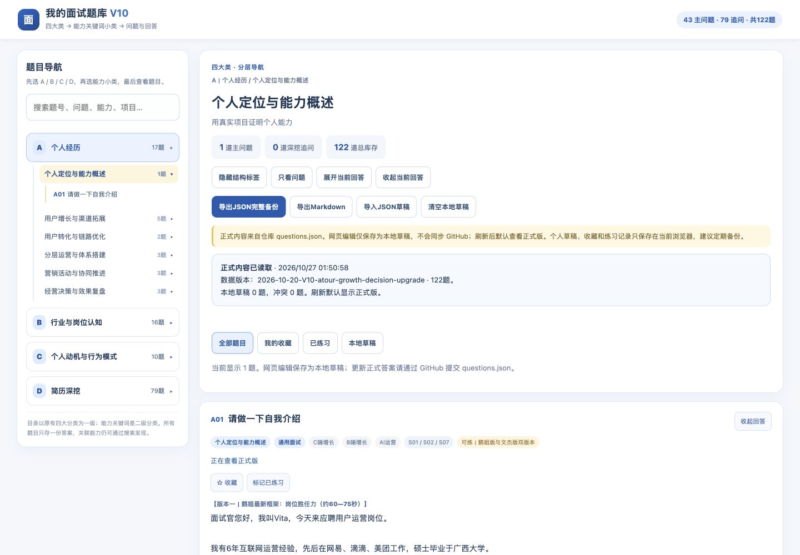
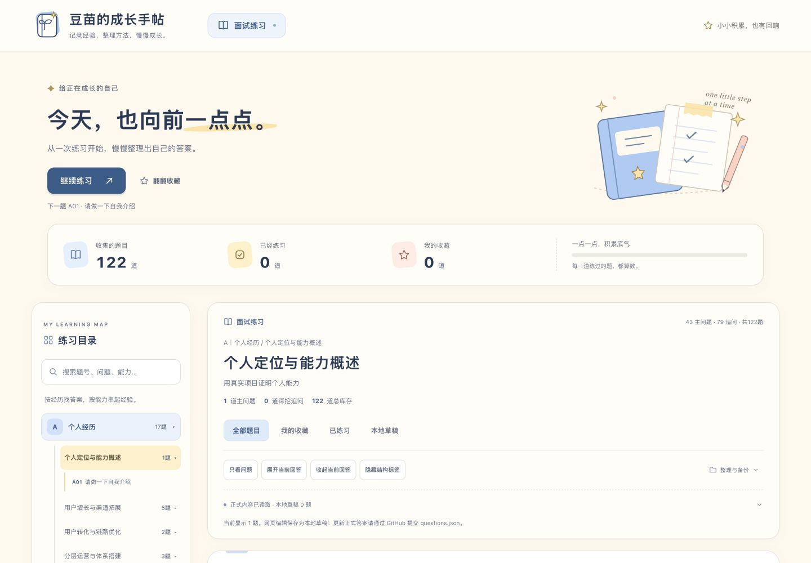
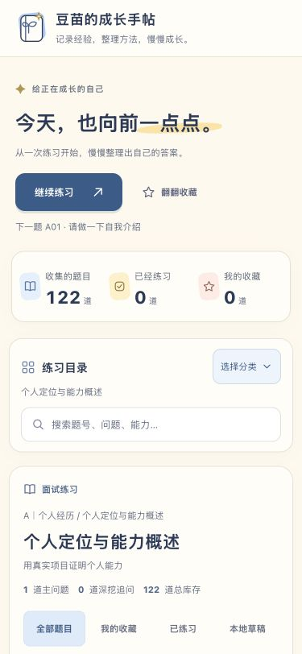
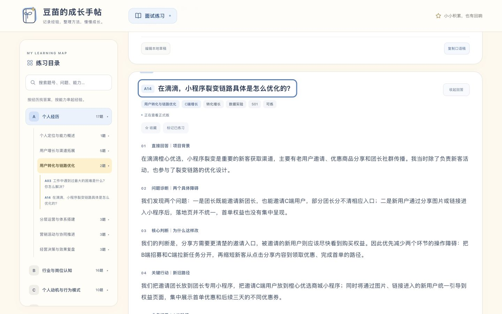
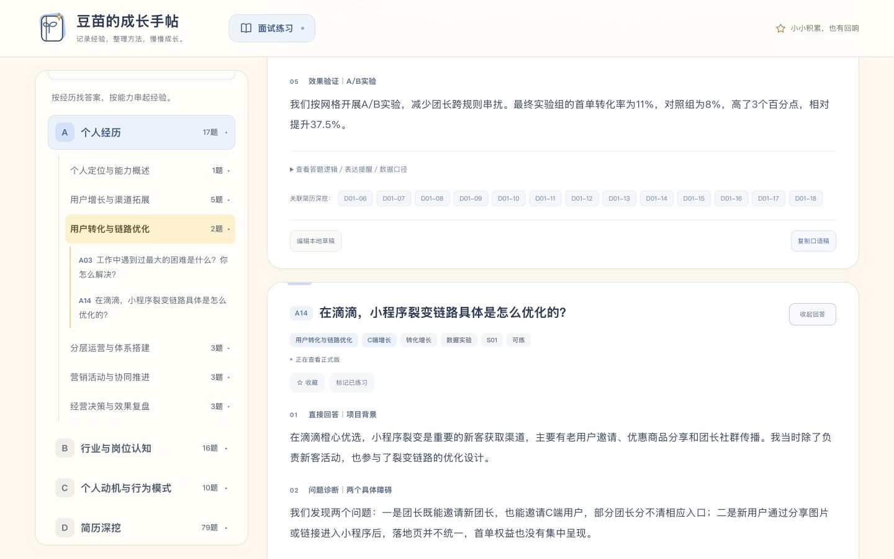

# 成长手帖 UI 改版与验收

开发基线：`main` 提交 `2c145b8f11a030641eb1648b59db9a492e5ca019`。提交前同步到 `c94a2178625be988055fe344b1589dbae50714e2`；上游仅更新了题库内容，UI代码没有冲突。PR以该最新提交为父提交，完整保留其正式题库。2026-10-27 完成浏览器回归。独立分支 `codex/doumiao-growth-notebook-ui`，仅提交 PR，等待用户审核后合并；不直接修改线上 main。

## 改版前后

| 原版桌面 | 改版桌面 |
| --- | --- |
|  |  |

| 原版手机 375px | 改版手机 375px |
| --- | --- |
|  |  |

[平板 768px](images/after-tablet.jpg) · [手机 390px](images/after-mobile-390.jpg) · [桌面答案阅读](images/after-desktop-reading.jpg) · [手机多版本答案阅读](images/after-mobile-reading.jpg)

## 视觉系统与交互

- 奶油纸面 `#FFF9EE`、柔和蓝 `#A9CBF5`、奶油黄 `#FFE3A2`、蜜桃 `#FFD0C2`；深蓝正文 `#283B58`。使用系统中文字体、细边框、圆角与轻阴影，没有外部字体请求或大型UI依赖。
- 原生SVG手帖Logo、星星与纸笔插画；全局品牌、欢迎概览、练习目录与阅读区形成统一层级。品牌配置集中于 `assets/notebook.mjs`。
- 总题数、已练题数、收藏数和进度动态计算，忽略已移除的题号。继续练习从最近已练题之后寻找下一道未练题，环绕目录；不自动标记已练。全练完可重新复习。
- 860px及以下目录默认折叠，搜索保持可见；分类选完收起目录并恢复焦点。未保存编辑时可以开关菜单，但导航与重绘仍被保护。
- 中文正文桌面16px、手机16px，行高2.05；段落序号和Part/版本分隔提升长答案可读性。收藏/练习状态、聚焦与按钮反馈保持清晰。
- 备份工具与同步详情收拢，保留原功能；检测到旧版草稿、冲突、孤立草稿或存储不可用时自动展开提示。弹窗背景inert，支持Esc与Tab循环。

## 自动检查与数据保护

`npm run check`：122题，A17/B16/C10/D79；30项测试通过（原23项＋5项概览/继续练习＋2项旧版迁移提示）。新增逻辑经过失败测试到通过测试的验证。JS语法与git diff检查通过。

`questions.json` SHA-256：`e8b11d7c2558d85f3d3b1a85707685b0f7ea5db6c1dc784ace33617b74259eb6`，与提交前最新main字节完全一致；`assets/core.mjs` 未改。本地 `drafts-v1`、`progress-v1` 及全部旧版key未变，导入导出结构未变。

工作流仍为原来的Pages/Actions，只在明确的站点产物白名单中加入 `assets/notebook.mjs`。PR运行校验测试，非main不会打包上传或部署。截图与文档只在仓库中，不进入站点产物。

## 实际浏览器验证

| 项目 | 结果 |
| --- | --- |
| 1440×1000、768×1024、390×844、375×812 | 四种尺寸文档scrollWidth均等于viewport，无横向溢出；小屏目录默认收起，桌面展开 |
| 全部分类与答案 | 逐一打开28个小类、展开全部122题，122个唯一ID、267段非空回答，展开后无隐藏回答 |
| 搜索与显示 | A10题号搜索、单条与批量展开/收起、只看问题/恢复回答、多版本标题通过 |
| 收藏与练习 | 真实计数0→1，筛选得到对应题目；刷新后状态保留；继续练习定位A11且没有增加已练数量 |
| 编辑保护 | 未保存标题时切换筛选被阻止，输入保留；375px开关目录未丢失编辑 |
| 草稿切换与刷新 | 保存A10临时草稿、切换本地/正式、对比两版均正常；刷新默认正式标题，草稿仍保留 |
| JSON备份 | 实际下载并解析122条正式记录，localState含单独A10草稿，正式标题没有临时内容 |
| Markdown | 实际下载，品牌标题正确，包含122个题目标题和A10 |
| JSON导入与冲突 | 粘贴一条修改后先预览，明确提示将替换现有草稿；确认后正式答案未变，提示冲突并可对比/保留草稿 |
| 键盘与弹窗 | 导入窗口Tab从末项回到文件框；对比窗口Esc关闭并解除背景inert；手机目录Enter打开、选组后关闭并聚焦开关 |
| 删除确认 | 取消保留临时草稿，确认仅删除该草稿；本次新建收藏/练习标记已清理，题库数据未动 |
| 控制台 | 验收页面无错误日志 |

独立代码审查发现“旧版草稿迁移入口藏于折叠区”的P2，已修复并新增2项真实renderSync行为测试，修复前失败、修复后通过。

## 目录与字体微调

根据截图反馈，中文字体优先使用苹方、微软雅黑UI等系统字体，并减轻品牌及内容标题字重。桌面侧栏从274px调整到328px，1440px及以上从282px调整到344px；861–1120px使用290px，860px及以下保留折叠目录。

桌面一级分类、小类、题目字号分别从12/11/10px提升至16/14/13px，搜索14px、数量12px。手机目录为15/14/13px，保留原来的操作与数据存储方式。本次只改CSS与验收文档、截图。

| 调整前 | 加宽并放大文字后 |
| --- | --- |
|  |  |

[375px手机目录](images/sidebar-mobile-375.jpg)。实际复查1440、1024、861、768、390、375px视口，无横向溢出；目录文字无内部横向溢出，最长一级分类可正常展示。手机搜索、目录展开/收起及答案展开/收起正常，控制台无错误。`npm run check`通过，122题与30项测试保持不变。

## 范围与限制

仅实现面试练习，没有不可用的运营方法/项目复盘/AI实践入口。草稿、收藏和练习记录仍只保存于当前浏览器，不自动同步设备。响应式验证使用桌面浏览器的四种视口，未宣称完成真实iOS/Android设备全浏览器测试。线上正式内容将在审核合并后由原工作流发布。
