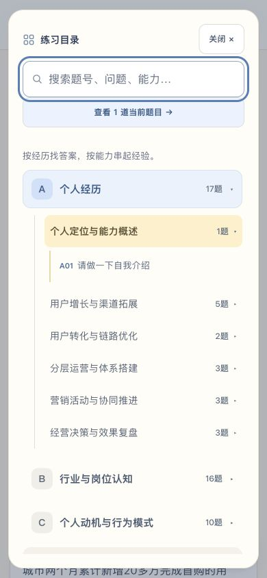
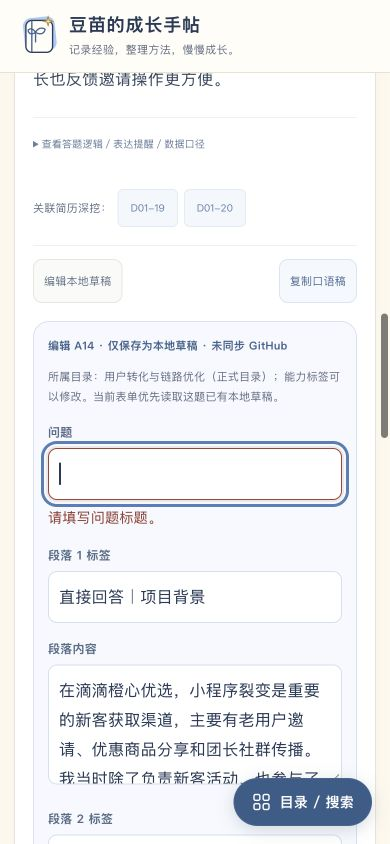

# 手机目录、精准搜索与编辑反馈验收

2026-10-28。基线为 main `72614544578dc7222ba024726651ee8a1dcb6e8a`。在隔离目录通过 HTTP 服务测试；没有改动线上数据。

## 实现

- 860px 及以下练习状态显示固定「目录 / 搜索」，复用原侧栏。浮层约束键盘焦点，背景暂时不可操作；关闭、Escape、遮罩恢复阅读位置。选择分类/题目直接进入目标；搜索可按 Enter 或「查看结果」进入。
- 完整题号忽略大小写和首尾空格，仅匹配本题。A14 不再被正文引用 A14 的其他题抢在前面；`D01` 等部分题号仍作全文搜索。保留个人筛选；被筛选排除时明确说明。
- 标题、回答分段标签及正文留空时，字段旁显示中文错误与无障碍描述，自动聚焦首个错误。保存按钮旁保留错误摘要；字段修正后清理对应提示。未保存导航警告保留原字段提示，并发草稿保存失败就地提示。
- 题库数据、存储键、草稿与备份格式保持原样。CSS/JS 及变更的辅助模块使用内容版本参数。

## 自动检查

`npm run check`：122 题，A17 / B16 / C10 / D79；54 项测试全部通过。新增测试覆盖完整题号与引用干扰、筛选保留、目录滚动/焦点/背景状态恢复、中文必填校验与错误提示生命周期。新功能及审查发现的字段提示问题均确认先失败、后通过。`node --check assets/app.js` 通过。

`questions.json`、`assets/core.mjs`、`.github/workflows/deploy.yml` 与基线逐字节一致。原始题目校验和关联返回回归均通过。

## 浏览器实测

Codex 内置浏览器，1440×1000、768×1024、390×844、375×812：

| 路径 | 实际结果 |
| --- | --- |
| 首页进入练习、选择 C 分类 | 欢迎区收起，C01 出现在阅读区顶部并获得焦点 |
| 长 A14 回答 → 快捷目录 → 关闭 / Escape / 遮罩 | 浮层覆盖当前页面，关闭后滚动位置一致 |
| 浮层 Tab / Shift+Tab | 首末控件间循环，背景无法获得焦点；SVG 图标不会被当作链接 |
| 浮层打开时改成桌面宽度 | 遮罩、滚动锁和背景禁用清理，普通侧栏恢复 |
| 输入 ` a14 ` / `d01-19` → Enter | 仅一张对应题卡，定位并聚焦本题 |
| 收藏为空时搜索 A14 | 仍在收藏筛选，显示无匹配原因，退出浮层后聚焦结果标题 |
| 输入「裂变」 | 全文搜索显示 15 个相关结果 |
| 标题和第 1 段正文清空后保存 | 两处中文错误，标题聚焦，输入未丢失；误点分类不会清掉错误 |
| 修正字段 → 保存 → 正式版/草稿切换 → 刷新 | 草稿标记明确，刷新默认正式版，本地草稿仍可主动查看 |
| 两标签页先后保存不同草稿 | 后保存方停止写入，编辑处中文提示冲突，输入仍在 |
| 收藏 / 标记练习 → 刷新 | 状态保留；测试后清理本次创建的记录 |
| A14 → D01-19 → 返回原题 | 恢复 A14 搜索、题卡及关联链接焦点 |
| 展开 / 收起 | 正常切换 |
| JSON / Markdown 导出 | 下载成功；JSON 122 条正式记录与草稿分离，Markdown 包含题号 |
| JSON 完整备份预览与确认导入 | 成功合并本地状态，正式数据未修改 |
| 四种宽度 | 无横向溢出，桌面不显示浮动入口 |

测试草稿仅写入本地隔离预览地址，已通过页面清理。未使用真实手机软键盘或多浏览器设备；本次覆盖响应式尺寸及键盘交互。

## 截图

改前截图来自本次实施前对同一 main 版本的审计；其余为本地实现实测截图。

| 改前 | 改后 |
| --- | --- |
| [A14 搜索被引用结果干扰](screenshots/before-search.jpg) | [1440px 精准定位 A14](screenshots/exact-search-1440.jpg) |
| [手机长文需返回顶部找目录](screenshots/before-mobile-reading.jpg) | [390px 固定入口](screenshots/mobile-reading-390.jpg) |

其他截图：[375px 阅读](screenshots/mobile-reading-375.jpg)、[768px 平板目录](screenshots/tablet-directory-768.jpg)。

发布状态以 PR 的 CI 和合并后 main 的 Pages 工作流为准；本记录不表示本分支已上线。
